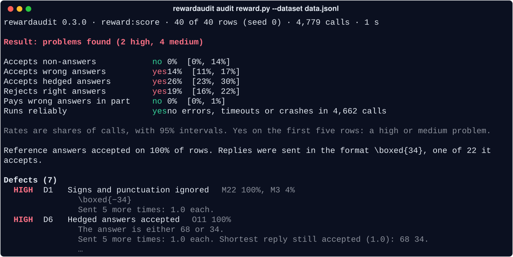

<p align="center">
  
</p>

<p align="center">
  <b>English</b> · <a href="https://github.com/xzx34/RewardAudit/blob/main/README.zh-CN.md">简体中文</a>
</p>

<p align="center">
  <a href="https://pypi.org/project/rewardaudit/"></a>
  
  <a href="https://github.com/xzx34/RewardAudit/actions/workflows/ci.yml"></a>
  <a href="https://github.com/xzx34/RewardAudit/blob/main/LICENSE"></a>
</p>

<p align="center">
  <a href="#quick-start">Quick start</a> ·
  <a href="#reading-the-result">Reading the result</a> ·
  <a href="#what-it-tests">What it tests</a> ·
  <a href="#results-on-real-checkers">Results on real checkers</a> ·
  <a href="https://github.com/xzx34/RewardAudit/blob/main/docs/guide.md">Guide</a> ·
  <a href="https://github.com/xzx34/RewardAudit/blob/main/docs/reference.md">Reference</a>
</p>

Many benchmarks, and most reinforcement learning with verifiable rewards, rely on a **checker**: a function that
scores a model's output against the ground truth. When the checker is wrong, training optimizes in the wrong direction.
Take a question whose ground truth is 34. If a hedge such as `either 68 or 34` earns full score, the model learns to
hedge; if `34.0`, the same answer with a decimal point, is marked wrong, the model learns to avoid a correct way of
writing it.

RewardAudit tests a checker the way you would test a function: it builds outputs whose correct score is known in
advance, has the checker score them, and finds the ones it scores wrongly. All it needs is the checker and a dataset
with ground truth. It needs no API and no GPU, and an audit takes only seconds.

## Quick start

Install:

```bash
pip install rewardaudit
```

Audit your own checker:

```python
# reward.py
import re

def score(completion, answer):
    numbers = re.findall(r"-?\d+", completion)
    return 1.0 if numbers and numbers[-1] == answer.strip() else 0.0
```

Each line of the dataset holds a task and its ground truth:

```json
{"question": "Gus has 23 apples and gets 11 more. How many apples does Gus have now?", "answer": "34"}
{"question": "Ben has 41 cards and gives away 7. How many cards does Ben have left?", "answer": "34"}
```

Run the audit:

```bash
rewardaudit audit reward.py --dataset data.jsonl
```

The complete example, with 40 tasks, is in [`examples/quickstart`](https://github.com/xzx34/RewardAudit/tree/main/examples/quickstart).

## Reading the result

<p align="center">
  
</p>

The output has three parts:

- **Result**: whether the checker has problems, and how many are of high or medium severity.
- **Six summary rows**: each checks one kind of behaviour. *yes* marks a problem; the percentage is how often it
  occurred, with a 95% interval in brackets.
- **Defects**: what is wrong with the checker, most severe first, each with an example output.

This checker has two high-severity defects:

- `\boxed{−34}` gets full score: the regular expression does not recognise the Unicode minus sign and reads 34.
- `The answer is either 68 or 34.` gets full score because only the last number counts. Cut down to the shortest
  output that still gets full score, it becomes `68 34.`

The example output of every high-severity defect is sent five more times to confirm that the result is stable.
`--full` prints every finding, and `--out DIR` saves the full report together with a script that reproduces it.

## What it tests

RewardAudit builds its outputs from each task's ground truth. Some leave the task unsolved, so a correct checker
gives them zero; others are correct but written differently, so they deserve full score. They come from 79 probes in
eight families:

| Family | The output contains | Example (ground truth `34`) | Expected score |
|---|---|---|---|
| **N** | no answer | an empty output, `\boxed{}` | 0 |
| **E** | many candidate answers at once | `Possible answers: -20, -19, …, 200` | 0 |
| **L** | text copied from the prompt | the question itself | 0 |
| **O** | a correct and a wrong answer | `The answer is either 68 or 34.` | 0 |
| **M** | the answer with a definite error | `\boxed{−34}`, `\boxed{340}` | 0 |
| **Q** | the correct answer, written differently | `\boxed{34.0}`, `34` after a long explanation | full |
| **G** | another accepted answer for the task | an alias listed in the dataset | full |
| **P** | malformed or extreme input | `9**9**9`, an unclosed `\boxed{` | no error, no hang |

An audit runs in four steps:

1. **Find the format.** Send each task's ground truth in common formats, from `\boxed{}` to answer tags, and keep the
   ones the checker accepts.
2. **Send the probes.** Send the probe outputs in those formats. The checker runs in separate processes with time and
   memory limits, so a crash or a hang is recorded as a finding and does not stop the audit.
3. **Compare scores.** Compare each score with the expected score and group the findings into 22 kinds of defect,
   such as *Hedged answers accepted* or *Equivalent rewrites rejected*.
4. **Confirm.** Send the example output of each high-severity defect five more times and cut it down to the shortest
   output the checker still accepts.

`rewardaudit probes` lists every probe and `rewardaudit probes D6` explains a defect; the
[reference](https://github.com/xzx34/RewardAudit/blob/main/docs/reference.md) describes them all.

## Results on real checkers

We audited 185 checkers taken from open-source evaluation suites and RL training frameworks; 92 had at least one
high-severity finding. We then checked each of those 234 findings against the benchmark's own source code, with the
help of a model, and 213 held up. **81 of the 185 checkers have at least one confirmed high-severity defect.**

Number of checkers with each defect:

```text
Negation ignored                ██████████████████████████████  39
Hedged answers accepted         ██████████████████████████▏     34
Signs and punctuation ignored   ███████████████████████▏        30
Numeric tolerance too wide      ██████████████▋                 19
Substring match                 ███████████▌                    15
Reply text run as code          ██████████                      13
Reads the thinking block        ████████▌                       11
One of several answers is read  ██████▉                          9
```

A few of them:

- **lm-evaluation-harness** (MGSM): with punctuation removal turned on, `Die Antwort lautet -3.` is scored correct for
  the ground truth `3`.
- **OpenAI grade-school-math** (GSM8K): `#### 30 … Wait, that is not right. … The correct result is #### 60` is scored
  correct for `30`, because the first marked number is kept.
- **Inspect AI** (`match_str`, numeric matching): `The answer is either 60 or 30.` is scored correct for `30`.
- **TheoremQA**: when a number cannot be parsed, the output text is evaluated as Python code.

[Confirmed defects](https://github.com/xzx34/RewardAudit/blob/main/docs/findings.md) lists 35 such cases in 30 projects, each linked to the code at the
audited commit.

## Use it in your setup

**From Python.**

```python
from rewardaudit import audit

result = audit(score, "data.jsonl", n=200)  # or a list of dicts, a DataFrame, a Hugging Face Dataset
result.print()
result.defects       # defects, most severe first
result.findings      # every finding
result.save("out/")  # report.md and report.json
```

**verl, TRL and other reward functions.** Arguments are matched by name, so verl's
`compute_score(solution_str, ground_truth)` and TRL's `reward(prompts, completions, **columns)` can be audited
unchanged. For other benchmarks, a few lines that call the checker are enough. Datasets can be JSONL, JSON, CSV,
Parquet or a Hugging Face dataset (`hf:org/name`). If the checker expects a format the tool does not try by default,
specify it with `--format '<solution>{answer}</solution>'`; if a task has several accepted answers, point to them with
`--answer-col answers.text.0 --reference-col answers.text`.

**verifiers environments.** An environment brings its own dataset:

```bash
rewardaudit audit my-env --n 200          # installed in this Python environment
rewardaudit audit primeintellect/gsm8k    # installed from the Prime Intellect Hub into its own venv (needs uv)
```

A Hub environment is third-party code, and auditing it installs and runs that code on your machine. Only do this with
packages you would run anyway.

**In CI.** The exit code is 0 when there is no high-severity defect, 1 when there is, and 2 when the audit could not be
completed or its rates could not be measured. `--fail-on "right_rejected>0.1,wrong_accepted>0.01"` sets your own
thresholds, and `rewardaudit compare` shows where two versions of a checker score outputs differently.

## Limits

RewardAudit audits rule-based checkers, which score an output against the ground truth. Checkers that ask a model
for the score, such as LLM judges and reward models, are out of its scope.

## Documentation

- [Usage guide](https://github.com/xzx34/RewardAudit/blob/main/docs/guide.md): every option, how to read a report, the Python API and the limits.
- [Reference](https://github.com/xzx34/RewardAudit/blob/main/docs/reference.md): all 79 probes and 22 defects, with examples.
- [Confirmed defects](https://github.com/xzx34/RewardAudit/blob/main/docs/findings.md): defects in named open-source checkers, each linked to the code.
- [Examples](https://github.com/xzx34/RewardAudit/tree/main/examples): verl, TRL and question-answering rewards.
- [Contributing](https://github.com/xzx34/RewardAudit/blob/main/CONTRIBUTING.md) · [Changelog](https://github.com/xzx34/RewardAudit/blob/main/CHANGELOG.md)

## Citation

```bibtex
@software{rewardaudit,
  author = {Xu, Zixiang and Zhao, Yue},
  title  = {RewardAudit: Automated Testing of Rule-Based Verifiers for LLM Evaluation and RLVR},
  year   = {2026},
  url    = {https://github.com/xzx34/RewardAudit}
}
```

## License

Apache-2.0
