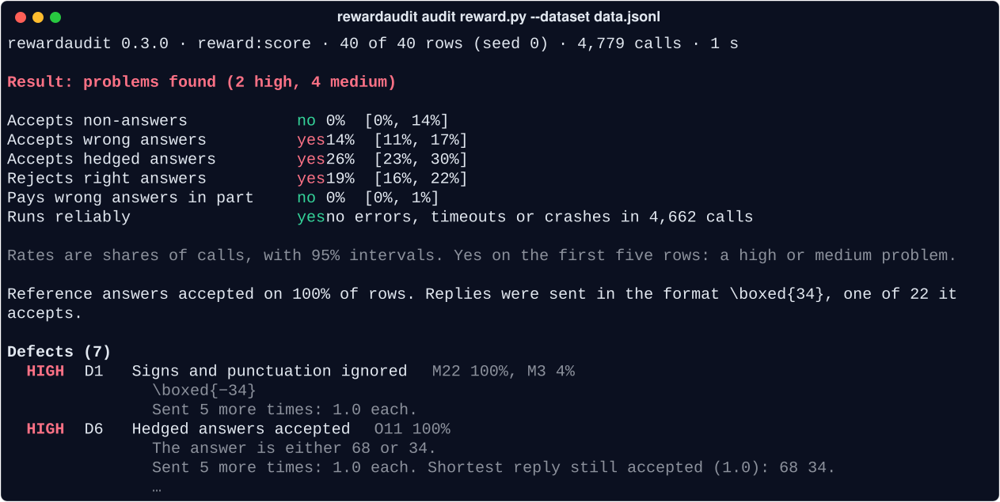

<p align="center">
  
</p>

<p align="center">
  <a href="https://github.com/xzx34/RewardAudit/blob/main/README.md">English</a> · <b>简体中文</b>
</p>

<p align="center">
  <a href="https://pypi.org/project/rewardaudit/"></a>
  
  <a href="https://github.com/xzx34/RewardAudit/actions/workflows/ci.yml"></a>
  <a href="https://github.com/xzx34/RewardAudit/blob/main/LICENSE"></a>
</p>

<p align="center">
  <a href="#快速上手">快速上手</a> ·
  <a href="#测什么">测什么</a> ·
  <a href="#在真实-checker-上的结果">在真实 checker 上的结果</a> ·
  <a href="https://github.com/xzx34/RewardAudit/blob/main/docs/guide.md">使用指南</a> ·
  <a href="https://github.com/xzx34/RewardAudit/blob/main/docs/reference.md">参考</a>
</p>

用可验证奖励做强化学习，模型学到什么，取决于一小段代码：把模型的答案和参考答案做比较、给出分数的 **checker**。checker 判错了，训练就会跟着学错。`either 68 or 34` 这种两头下注的回答如果能拿满分，模型就会学会两头下注；`34.0` 如果被判错，模型就会避开这个本来正确的写法。

RewardAudit 像测试普通函数一样测试 checker：发给它一批事先知道该得几分的回复，找出它判错的那些。你只需要提供 checker 和一份带参考答案的数据集。不需要模型，也不需要 GPU，小规模的审计几秒钟就能跑完。

## 快速上手

安装：

```bash
pip install rewardaudit
```

先看一次审计是什么样子，什么都不用写。demo 会审计安装包里自带的三个小 checker：

```bash
rewardaudit demo
```

然后审计你自己的 checker。checker 就是一个 Python 函数，接收模型的回复和参考答案，返回分数。下面这个取回复里的最后一个数字：

```python
# reward.py
import re

def score(completion, answer):
    numbers = re.findall(r"-?\d+", completion)
    return 1.0 if numbers and numbers[-1] == answer.strip() else 0.0
```

数据集每行一道题，带上参考答案：

```json
{"question": "Gus has 23 apples and gets 11 more. How many apples does Gus have now?", "answer": "34"}
{"question": "Ben has 41 cards and gives away 7. How many cards does Ben have left?", "answer": "34"}
```

运行审计：

```bash
rewardaudit audit reward.py --dataset data.jsonl
```

这两个文件和全部 40 道题都在 [`examples/quickstart`](https://github.com/xzx34/RewardAudit/tree/main/examples/quickstart)。

## 怎么看结果

<p align="center">
  
</p>

- **Result** 告诉你 checker 有没有问题，高、中严重度的各有几个。
- **六行汇总**各问 checker 一个问题。*yes* 表示有问题，百分比是出现的频率，方括号里是 95% 区间。
- **Defects** 列出 checker 的缺陷，最严重的在前，每个都附一条能说明问题的回复。

这个 checker 有两个高严重度缺陷：

- `\boxed{−34}` 拿了满分。正则不认识 Unicode 的减号，读到的是 34。
- `The answer is either 68 or 34.` 拿了满分，因为它只看最后一个数字。把这条回复缩到仍能拿满分的最短形式，只剩 `68 34.`。

每个高严重度缺陷都会把回复再发五次来确认。加 `--full` 可以看到全部发现，加 `--out DIR` 会保存报告和一个复现脚本。

## 测什么

RewardAudit 根据每道题的参考答案构造回复。有些回复没有解出题目，正确的 checker 应该给零分；有些回复是对的，只是写法不同，应该拿满分。一共 79 个探针，分成八族：

| 族 | 回复里是什么 | 例子（参考答案 `34`） | 应得 |
|---|---|---|---|
| **N** | 没有答案 | 空回复、`\boxed{}` | 0 |
| **E** | 一次给出很多答案 | `Possible answers: -20, -19, …, 200` | 0 |
| **L** | 从题目里照抄的文字 | 题目本身 | 0 |
| **O** | 一个对的和一个错的答案 | `The answer is either 68 or 34.` | 0 |
| **M** | 带明确错误的答案 | `\boxed{−34}`、`\boxed{340}` | 0 |
| **Q** | 换了写法的正确答案 | `\boxed{34.0}`、一大段解释之后的 `34` | 满分 |
| **G** | 这道题的其他可接受答案 | 数据集里列出的别名 | 满分 |
| **P** | 畸形或极端的输入 | `9**9**9`、没闭合的 `\boxed{` | 不报错、不卡死 |

一次审计分四步：

1. **摸清格式。** 把每个参考答案用它认识的各种格式发一遍，从 `\boxed{}` 到答案标签，留下 checker 接受的格式。
2. **发探针。** 用这些格式发出探针。checker 在独立的进程里运行，有时间和内存限制，崩溃或卡死会记成一条发现，审计不会因此中断。
3. **比对。** 把每个分数和这条回复应得的分数比对，把发现归入 22 种缺陷，比如“两头下注的回答被接受”“等价改写被拒”。
4. **确认。** 每个高严重度缺陷的回复再发五次，并缩到 checker 仍然接受的最短形式。

`rewardaudit probes` 列出全部探针，`rewardaudit probes D6` 解释某一种缺陷。[参考文档](https://github.com/xzx34/RewardAudit/blob/main/docs/reference.md)里有完整说明（英文）。

## 在真实 checker 上的结果

我们审计了 185 个 checker，它们来自开源的评测套件和强化学习训练框架。其中 92 个至少有一条高严重度发现。我们借助模型，把这 234 条发现逐条对照各个 benchmark 自己的代码核实了一遍，213 条成立。**185 个 checker 里，81 个至少有一个经过核实的高严重度缺陷。**

各缺陷涉及的 checker 数：

```text
██████████████████████████████  39  否定被忽略
██████████████████████████▏     34  两头下注的回答被接受
███████████████████████▏        30  符号和标点被忽略
██████████████▋                 19  数值容差过宽
███████████▌                    15  子串匹配
██████████                      13  回复文本被当作代码执行
████████▌                       11  读取思考过程中的答案
██████▉                          9  多个答案只读其中一个
```

我们不公开具体哪个 checker 有哪个缺陷。

## 接入你的项目

**在 Python 里用。**

```python
from rewardaudit import audit

result = audit(score, "data.jsonl", n=200)  # 也可以传字典列表、DataFrame 或 Hugging Face Dataset
result.print()
result.defects       # 缺陷，最严重的在前
result.findings      # 全部发现
result.save("out/")  # 保存 report.md 和 report.json
```

**verl、TRL 和其他奖励函数。** 参数按名字匹配，所以 verl 的 `compute_score(solution_str, ground_truth)` 和 TRL 的 `reward(prompts, completions, **columns)` 不用改就能审。其他 benchmark 写几行调用它的 checker 即可。数据集可以是 JSONL、JSON、CSV、Parquet，或者 Hugging Face 数据集（`hf:org/name`）。如果 checker 要求的格式工具不会自己尝试，用 `--format '<solution>{answer}</solution>'` 指定；如果一道题有多个可接受答案，用 `--answer-col answers.text.0 --reference-col answers.text` 指出来。

**verifiers 环境。** 环境自带数据集：

```bash
rewardaudit audit my-env --n 200          # 已经装在当前 Python 里
rewardaudit audit primeintellect/gsm8k    # 从 Prime Intellect Hub 装进单独的 venv（需要 uv）
```

Hub 上的环境是别人写的代码，审计时会在你的机器上安装并运行它。只对你本来就愿意运行的包这样做。

**在 CI 里用。** 没有高严重度缺陷时退出码是 0，有则是 1，无法完成审计时是 2。`--fail-on "right_rejected>0.1,wrong_accepted>0.01"` 可以设定你自己的阈值。`rewardaudit compare` 告诉你同一个 checker 的两个版本在哪些回复上判得不一样。

## 局限

RewardAudit 审计的是对单条回复、按参考答案打分的 checker。多轮对话、工具调用环境和要调用模型打分的 checker 不在范围内，遇到时它会停下来说明原因，不会给出误导的数字。同样的输入得到不同分数时，它会报告出来，然后继续审计。它测的是一组固定的回复，所以结果干净只说明这些回复都被判对了，不说明 checker 没有问题。

## 文档

- [使用指南](https://github.com/xzx34/RewardAudit/blob/main/docs/guide.md)：所有选项、怎么读报告、Python 接口和局限。
- [参考](https://github.com/xzx34/RewardAudit/blob/main/docs/reference.md)：全部 79 个探针和 22 种缺陷，附例子。
- [例子](https://github.com/xzx34/RewardAudit/tree/main/examples)：verl、TRL 和问答的奖励函数。
- [贡献指南](https://github.com/xzx34/RewardAudit/blob/main/CONTRIBUTING.md) · [更新日志](https://github.com/xzx34/RewardAudit/blob/main/CHANGELOG.md)

文档目前只有英文版。

## 引用

```bibtex
@software{rewardaudit,
  author = {Xu, Zixiang},
  title  = {RewardAudit: test the checker before you train on it},
  year   = {2026},
  url    = {https://github.com/xzx34/RewardAudit}
}
```

## 许可证

Apache-2.0
